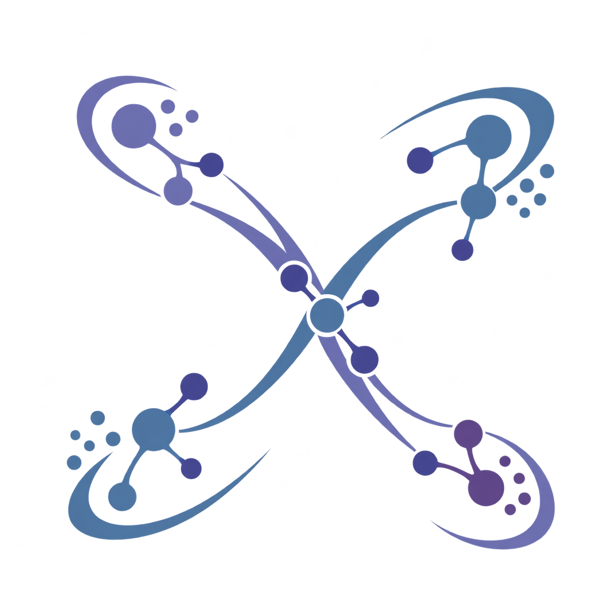

<p align="center"></p>

<p align="center">
  <a href="https://github.com/AbdelheqMokhtari/PolyClustX/releases/latest"></a>
  
  <a href="https://github.com/AbdelheqMokhtari/PolyClustX/actions/workflows/ci.yml"></a>
  <a href="LICENSE"></a>
  <a href="https://polyclustx.readthedocs.io/en/latest/"></a>
</p>

# PolyClustX

**A Unified Framework for Multi-View and Multimodal Representation Learning and Clustering from Feature Views to Attributed Graphs**

Prepare data, compare algorithms, tune hyperparameters and visualize results
through one Python API, command line or graphical interface. Work with one or
many feature views, optional graphs and optional ground-truth labels.

[Documentation](https://polyclustx.readthedocs.io/en/latest/) ·
[Models](docs/background/algorithms.md) · [Examples](notebooks/) ·
[Contributing](CONTRIBUTING.md)

## Install and launch

Python **3.10+** is required. Installation includes PyTorch, the interface and
Optuna—no separate interface installation is needed.

From PyPI, once the PolyClustX distribution is published:

```bash
python -m pip install polyclustx
polyclustx display
```

Or install from the repository:

```bash
git clone https://github.com/AbdelheqMokhtari/PolyClustX.git
cd PolyClustX
python -m pip install .
polyclustx display
```

Open the address printed in the terminal, normally http://localhost:8501.
If the command is not found, use `python -m polyclustx display`.
The [installation guide](docs/user_guide/installation.rst) covers environments
and migration from the former `pymv` package.

## Use Python

```python
from polyclustx.data import load_data
from polyclustx.models import MultiViewKMeans

data = load_data("acm")  # downloaded once, then cached
model = data.fit(MultiViewKMeans(n_clusters=data.n_clusters, random_state=42))
labels = model.labels_
embedding = model.embedding_
```

Compare several models and repeat each fit:

```python
from polyclustx.experiment import Experiment
from polyclustx.metrics import clustering_accuracy, nmi_score
from polyclustx.models import LMGEC, MultiViewKMeans

results = Experiment(
    datasets=["acm"],
    models=[
        MultiViewKMeans(n_clusters=3, random_state=42),
        LMGEC(n_clusters=3, embedding_dim=8, random_state=42),
    ],
    metrics=[clustering_accuracy, nmi_score],
    runs=3,
    save_path="experiments/comparison",
).run()

print(results.results_tables())  # scores across repeated runs
results.export("comparison.zip")  # JSON and CSV reports
```

Use `MultiViewDataset([view_1, view_2], labels=None)` for your own feature
matrices. Add graphs, align samples by ID or simulate missing views as needed.
See the [data guide](docs/user_guide/data.md) and
[experiment guide](docs/user_guide/experiments.md).

## Use the command line

```bash
polyclustx models
polyclustx models idec
polyclustx datasets
polyclustx run acm --model lmgec --param embedding_dim=8 --runs 3
polyclustx search acm --model lmgec --strategy grid --vary 'temperature=[0.5,1,2]'
```

Repeat `--param name=value` for fixed settings and `--vary name=values` for
search candidates. Search supports **grid, random and Optuna**, including
continuous ranges with Optuna. Choose the objective with `--objective`.
See the [CLI guide](docs/api/cli.rst).

## Available methods

Graphs ✓ means the method uses supplied adjacency matrices. Missing views ✓
means native support for an observation mask.

| Category | Method | Graphs | Missing views | Original publication |
|---|---|:---:|:---:|---|
| Graph-aware | LMGEC | ✓ | — | [Fettal et al., WSDM 2023](https://doi.org/10.1145/3539597.3570367) |
| Graph-aware | DGF | ✓ | — | [Zheng et al., Dual Graph Filtering](https://arxiv.org/abs/2511.20030) |
| Graph-aware | SGLA | ✓ | — | [Li et al., ICDE 2025](https://arxiv.org/abs/2508.09452) |
| Feature-based | MultiViewKMeans | — | — | [Bickel & Scheffer, ICDM 2004](https://doi.org/10.1109/ICDM.2004.10095) |
| Feature-based | MultiViewSpectralClustering | — | — | [Kumar & Daumé, ICML 2011](https://icml.cc/2011/papers/272_icmlpaper.pdf) |
| Feature-based | G-CoMVKM | — | — | [Sinaga & Yang, Electronics 2025](https://doi.org/10.3390/electronics14112129) |
| Feature-based | IDEC | — | — | [Guo et al., IJCAI 2017](https://www.ijcai.org/proceedings/2017/243) |
| Feature-based | CONAN | — | — | [Ke et al., BigData 2021](https://doi.org/10.1109/BigData52589.2021.9671851) |
| Feature-based | SCM | — | — | [Luo et al., IJCAI 2024](https://www.ijcai.org/proceedings/2024/519) |
| Feature-based | MFLVC | — | — | [Xu et al., CVPR 2022](https://github.com/SubmissionsIn/MFLVC) |
| Feature-based | UMC | — | — | [Zhang et al., ACL 2024](https://aclanthology.org/2024.acl-long.2/) |
| Incomplete-view | COMPLETER | — | ✓ | [Lin et al., CVPR 2021](https://github.com/XLearning-SCU/2021-CVPR-Completer) |
| Incomplete-view | DCP | — | ✓ | [Lin et al., TPAMI](https://doi.org/10.1109/TPAMI.2022.3197238) |

Capabilities differ by method. Some single-view and multi-view cases are
framework adaptations; UMC uses supplied features without pretrained encoders.
See [algorithm details, assumptions and references](docs/user_guide/clustering_models.md).
These implementations do not claim to reproduce the papers' benchmark scores.

## Explore and visualize

The interface provides dataset preparation, named models, repeated experiments,
hyperparameter search, visualizations and JSON/CSV/ZIP exports.
Labels enable benchmark metrics; without labels, use internal metrics.
[Interface guide](docs/user_guide/workbench.md).

The [notebooks](notebooks/) are **unexecuted tutorials** for you to run.
Start with [the end-to-end study](notebooks/06_polyclustx_feature_to_graph_study.ipynb)
to compare methods on Iris and Wine, add graphs, visualize embeddings and
losses, search hyperparameters and export results.

## Documentation

```bash
make docs-build    # build the documentation
make docs-serve    # open http://127.0.0.1:8000; no rebuild
make docs-deploy   # trigger a remote Read the Docs build; requires project access
```

The public documentation address is
[polyclustx.readthedocs.io](https://polyclustx.readthedocs.io/en/latest/).
Publication requires the renamed Read the Docs project to be connected.
[Deployment instructions](docs/contributing/documentation.md).

## Research affiliations

<p>
  <a href="https://centreborelli.ens-paris-saclay.fr/fr"></a>
  &nbsp;&nbsp;
  <a href="https://u-paris.fr/"></a>
</p>

Centre Borelli · Université Paris Cité.
Institutional marks remain separate from PolyClustX and do not imply endorsement.
See [asset provenance](docs/contributing/branding.md).

## License

The software is MIT licensed; see [LICENSE](LICENSE) and
[third-party notices](THIRD_PARTY_NOTICES.md). Institutional logos are not
covered by the software's MIT license. Cite the original algorithm papers
when publishing results.
