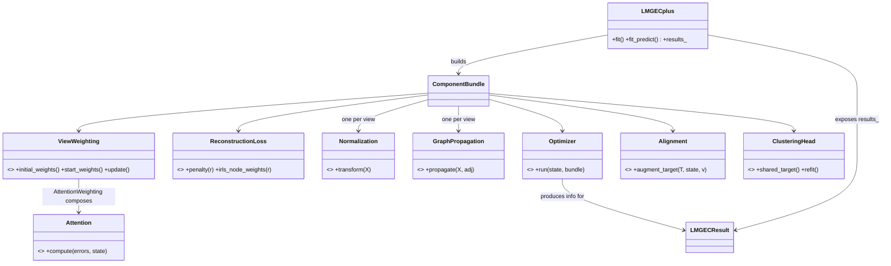

# LMGEC as a Modular Research Framework

`pymv.models.lmgecplus` turns LMGEC into a **composable research
platform**: every algorithmic ingredient — reconstruction loss, feature
normalization, graph propagation, attention, view weighting, cross-view
alignment, clustering head, and the optimizer itself — is an
interchangeable strategy object that can be enabled, disabled, or
replaced independently, from Python or from a YAML config.

This document covers the analysis of the previous implementation, the
new architecture, the rationale behind each design decision, recipes
for ablation studies and custom components, and how to test everything.

---

## 1. What was wrong with the monolith

The previous `LMGECplus.fit()` was a single ~130-line method that wired
eight boolean flags directly into the optimisation loop:

| Coupling | Consequence |
|---|---|
| `robust_loss` was an `if` inside the loop choosing between two hard-coded formulas | adding a Huber loss meant editing `fit()` in three places |
| attention / global weights were computed in three different branches (init, static, per-iteration) | a new weighting scheme required understanding the whole loop |
| preprocessing (`center/scale/tf_idf/beta/gamma`) was a nested `if` cascade in `_prepare_views` | normalizations could not be combined or configured per view |
| hard vs soft clustering was an `if/else` on state (`R is None`) | a GMM head was impossible without touching the loop |
| the loop itself lived inside the model class | alternative optimisation schemes required a new model |
| outputs were scattered ad-hoc attributes | analysis code had to know which flags populate which attribute |

Every new research idea therefore meant **editing the core algorithm**
and re-validating all existing behaviour by hand.

## 2. Architecture

```
                       ┌──────────────────────────────────────────────┐
   flags / specs ──▶   │ LMGECplus (facade)                           │
                       │  _build_components()  → ComponentBundle      │
                       └───────────────┬──────────────────────────────┘
                                       │
        Xs, As ──▶ Normalization ──▶ GraphPropagation ──▶ Hs  (per view)
                                       │
                                       ▼
                       ┌──────────────────────────────────────────────┐
                       │ Optimizer (AlternatingOptimizer)             │
                       │   owns init + loop, mutates one FitState     │
                       │                                              │
                       │  T  = ClusteringHead.shared_target()         │
                       │  Wᵥ = procrustes(Hᵥ, Alignment(T)) weighted  │
                       │       by β ⊙ ReconstructionLoss.irls(r)      │
                       │  β  = ViewWeighting.update()  (← Attention)  │
                       │  Z  = Σᵥ βᵥ ⊙ HᵥWᵥ                           │
                       │  G,F,R = ClusteringHead.refit()              │
                       │  loss = Σᵥ Σᵢ βᵥᵢ ρ(rᵥᵢ) + Alignment.penalty │
                       └───────────────┬──────────────────────────────┘
                                       ▼
                                  LMGECResult
```



### Modules and registered implementations

| Kind (`register_component`) | Implementations (registry names) |
|---|---|
| `loss` | `l2` (original), `l21` / `robust`, `huber` |
| `normalization` | `none`, `l2` (original), `tfidf`, `zscore`, `minmax`, `whitening`, `NormalizationPipeline` |
| `propagation` | `none`, `standard` / `original` (H = SX), `controlled` (γ, incl. `"auto"`) |
| `attention` | `node` / `dynamic`, `static`, `view` |
| `weighting` | `uniform`, `inertia` / `original`, `entropy`, `attention` |
| `alignment` | `none`, `consensus` / `original`, `cosine`, `contrastive` |
| `clustering` | `kmeans` / `hard` (original), `soft`, `gmm` |
| `optimizer` | `alternating` (`max_iter`, `tol`) |

All mutable optimisation state travels in a single `FitState`
dataclass, so component signatures never change when new state is
added.

### Module map

```
src/pymv/models/lmgecplus/
├── interfaces.py     # ABCs + FitState + ComponentBundle (the contracts)
├── factory.py        # per-kind registry, spec resolution (str/dict/instance)
├── components.py     # pure NumPy math kernels (unchanged, unit-tested)
├── losses.py         # L2Loss, L21Loss, HuberLoss
├── normalization.py  # No/L2/TfIdf/ZScore/MinMax/Whitening + Pipeline
├── propagation.py    # No/Standard/Controlled propagation
├── attention.py      # NodeLevel/Static/ViewLevel attention
├── weighting.py      # Uniform/Inertia/Entropy/Attention weighting
├── alignment.py      # No/Consensus/Cosine/Contrastive alignment
├── clustering.py     # HardKMeans/SoftKMeans/GMM heads
├── optimizer.py      # AlternatingOptimizer (init + loop + convergence)
├── result.py         # LMGECResult
├── ablation.py       # build_ablation_suite
└── lmgecplus.py      # the facade model (flags ∪ component specs)
```

## 3. Design rationale

* **Composition over inheritance.** `LMGECplus` *has* a loss, a head, a
  weighting — it *is not* one. The only inheritance in the framework is
  interface implementation and two named presets (`StaticAttention`,
  `EntropyWeighting`) that exist purely so configs read naturally.
* **IRLS as the loss contract.** LMGEC's updates stay closed-form for
  any loss expressible as iteratively re-weighted least squares. A loss
  therefore only supplies `penalty(r)` and `irls_node_weights(r)` —
  `l2` returns unit weights (the plain LMGEC path), `l21` returns
  `1/(2r)`, Huber returns `min(1, δ/r)`. New robust losses (Cauchy,
  Welsch, …) are one class each, and the optimizer never changes.
* **Alignment as target augmentation.** The W-update is an orthogonal
  Procrustes problem; alignment strategies augment the regression
  target (`T + μ·a(Z_prev)`) instead of adding gradient terms, keeping
  every update closed-form. `cosine` and `contrastive` are documented
  linear surrogates of their namesake objectives, chosen so the solver
  is preserved (a full InfoNCE has no closed-form W-update).
* **Weighting vs attention are separate axes.** *View weighting*
  decides the fusion weights β; *attention* is one way of computing
  them. `AttentionWeighting` composes any `Attention` mechanism and a
  bootstrap strategy for the initial consensus (inertia by default,
  matching the original algorithm). This separation lets `uniform`,
  fixed `inertia`, view-level `entropy`, and node-level attention be
  ablated against each other without special cases in the loop.
* **The optimizer owns the loop.** Initialisation, updates, loss
  monitoring, and convergence live in `AlternatingOptimizer`; the model
  class only resolves components and collects results. Alternative
  schemes (e.g. stochastic or mini-batch variants) become new
  `optimizer` components.
* **Registry + specs for config integration.** Components resolve from
  `None` (derive from legacy flags), strings (`"l21"`), dicts
  (`{"enabled": true, "gamma": 0.4}` — YAML-friendly), classes, or
  ready instances. The same one-decorator registry pattern as
  `pymv.models.registry`, one level down.

## 4. Backward compatibility — verified bit-for-bit

The legacy flag API is unchanged and maps onto default components:

| Legacy flag | Component equivalent |
|---|---|
| *(defaults)* | `l2` + `inertia` + `standard` + `kmeans` + no alignment |
| `robust_loss=True` | `reconstruction_loss="l21"` |
| `node_attention=True` (+ `dynamic_attention`, `dim_normalized_attention`, `attention_regularization`) | `attention="dynamic"` / `"static"` / `NodeLevelAttention(...)` |
| `controlled_propagation=True, gamma=γ` | `graph_propagation={"enabled": True, "gamma": γ}` |
| `soft_clustering=True` | `clustering="soft"` |
| `cross_view_alignment=True` | `alignment="consensus"` |
| `center/scale/tf_idf` | `zscore` → `l2`/`tfidf` `NormalizationPipeline` |

The refactor was validated against the pre-refactor implementation on
12 flag configurations (default, robust, dynamic/static/regularised
attention, soft, alignment, controlled/auto propagation, per-view
normalization, `preprocess=False`, and a combined config): **labels,
loss history, embeddings, centroids, α's, attention and
responsibilities are bit-for-bit identical** with a fixed
`random_state`. Explicit component specs always win over conflicting
legacy flags.

New capabilities are strictly opt-in: `tol` (early stopping) defaults
to `None` (always run `max_iter`, as before) and `track_memory`
defaults to `False`. Existing code — `LMGEC(...)`, `LMGECplus(...)`,
the CLI, configs, `Experiment`, dashboards — runs
without modification.

## 5. The result object

`fit()` still returns `self` and populates the historical attributes
(`labels_`, `embedding_`, `centroids_`, `alphas_`, `attention_`,
`responsibilities_`, `gammas_`, `loss_history_`). In addition,
`model.results_` is an `LMGECResult` carrying every useful output:

```python
model = LMGECplus(n_clusters=10, embedding_dim=16, attention="dynamic",
                  clustering="soft", track_memory=True)
model.fit(Xs, As)

res = model.results_
res.embedding               # (n, m) consensus embedding
res.labels                  # (n,) hard labels
res.view_weights            # (V,) mean fusion weight per view
res.attention_weights       # (V, n) per-node attention (or None)
res.cluster_probabilities   # (n, k) soft assignments (or None)
res.reconstruction_errors   # per-view (n,) final squared errors
res.loss_history            # per-iteration monitored loss
res.convergence             # {"converged", "n_iter", "final_loss"}
res.view_projections        # per-view W_v
res.training_time           # seconds
res.memory_usage            # peak heap bytes (track_memory=True)
res.components              # human-readable module selection
print(res.summary())        # multi-line report
res.to_dict()               # JSON-friendly (for experiment logs)
```

## 6. Configuration files

Every component is configurable from pymv YAML configs; specs pass
through `model.params` untouched and reach the model via the CLI:

```yaml
dataset: acm

model:
  name: lmgecplus
  params:
    embedding_dim: 16
    reconstruction_loss: l21
    normalization: zscore
    attention: dynamic
    graph_propagation:
      enabled: true
      gamma: 0.4
    clustering:
      method: soft
    tol: 1.0e-6

experiment:
  runs: 3
  metrics: [acc, nmi, ari]
```

Run with `pymv-cli --config my_experiment.yaml`.

## 7. Ablation studies

The standard ladder follows the **eight LMGEC extensions** (each added
alone on top of the verified baseline — see
`docs/LMGEC_extensions.md` for the maths) and is one call — no code
duplication:

```python
from pymv.experiment import Experiment
from pymv.metrics import ari_score, clustering_accuracy, nmi_score
from pymv.models.lmgecplus import build_ablation_suite

suite = build_ablation_suite(n_clusters=3, embedding_dim=16,
                             max_iter=30, random_state=0)
# baseline, E1 robust-l21, E2 node-attention, E3 attn+dim-norm,
# E4 dynamic-alphas, E5 attn+entropy-reg, E6 controlled-prop,
# E7 soft-clustering, E8 alignment, full
Experiment(datasets=["acm", "dblp"],
           models=list(suite.values()),
           metrics=[clustering_accuracy, nmi_score, ari_score],
           runs=5).run()
```

Custom ladders are dictionaries of constructor overrides:

```python
suite = build_ablation_suite(
    n_clusters=3,
    variants={
        "baseline":   {},
        "huber":      {"reconstruction_loss": "huber"},
        "gmm-head":   {"clustering": "gmm"},
        "view-attn":  {"attention": "view"},
        "gamma-0.3":  {"graph_propagation": {"enabled": True, "gamma": 0.3}},
    },
)
```

Sensitivity analysis is a plain loop over one spec:

```python
for gamma in (0.0, 0.25, 0.5, 0.75, 1.0):
    m = LMGECplus(n_clusters=3, embedding_dim=16,
                  graph_propagation={"enabled": True, "gamma": gamma})
    m.fit(Xs, As)
```

A ready-to-run notebook lives at
[`notebooks/lmgec_ablation_study.ipynb`](../notebooks/lmgec_ablation_study.ipynb).

## 8. Extending the framework

A new mechanism is **one class** — no library edits:

```python
import numpy as np
from pymv.models.lmgecplus import ReconstructionLoss, register_component

@register_component("loss", "cauchy")
class CauchyLoss(ReconstructionLoss):
    """ρ(r) = c²/2 · log(1 + (r/c)²) — heavier-tailed than Huber."""

    def __init__(self, c: float = 1.0):
        self.c = c

    def penalty(self, r):
        return 0.5 * self.c**2 * np.log1p((r / self.c) ** 2)

    def irls_node_weights(self, r):
        return 1.0 / (1.0 + (r / self.c) ** 2)

LMGECplus(n_clusters=3, embedding_dim=8, reconstruction_loss="cauchy")
```

The same pattern applies to every kind: subclass the interface
(`Attention`, `Normalization`, `GraphPropagation`, `ViewWeighting`,
`Alignment`, `ClusteringHead`, `Optimizer`), optionally register a
name, and pass it (or its name/spec) to the constructor. Unregistered
instances work too — registration only enables string/YAML lookup.

## 9. How to test

The framework ships with two dedicated test files; both use the tiny
synthetic `mock_dataset` fixture (30 samples, 2 views), so they run in
seconds and need no downloaded data.

```bash
# 1. Component layer: every loss / normalization / propagation /
#    attention / weighting / alignment / head / optimizer in isolation,
#    factory resolution, result object, facade equivalence
#    (flag API ≡ component API), ablation builder, extensibility.
python -m pytest tests/test_lmgec_components.py -v

# 2. Legacy behaviour: flag toggles, LMGEC statistical parity,
#    registry/framework integration (pre-existing suite, unchanged).
python -m pytest tests/test_lmgecplus.py -v

# 3. Everything that touches models (quick regression sweep).
python -m pytest tests/test_lmgec_components.py tests/test_lmgecplus.py tests/test_models.py -q

# 4. Whole library.
python -m pytest tests/ -q
```

What is covered where:

| Concern | Test |
|---|---|
| Each component's math in isolation | `test_lmgec_components.py::TestLosses/TestNormalization/TestPropagation/TestAttention/TestWeighting/TestAlignment/TestClusteringHeads` |
| Component spec resolution (str / dict / instance / `enabled: false`) | `TestFactory` |
| `flag API ≡ component API` (identical labels, losses, embeddings) | `TestFacadeEquivalence` |
| Refactor preserves original defaults path | `TestFacadeEquivalence::test_defaults_reproduce_original_lmgec_path` + `test_lmgecplus.py::TestBackwardCompat` |
| Early stopping / convergence reporting | `TestOptimizer` |
| `LMGECResult` fields, JSON export, memory tracking | `TestResultObject` |
| One-class extensibility (custom loss / attention / alignment) | `TestExtensibility` |
| Registry defaults, `Experiment` deep-copy compat | `TestFrameworkIntegration` |
| Legacy flag toggles + LMGEC parity | `test_lmgecplus.py` (unchanged, still green) |

For a stronger end-to-end check on real data, run the ablation
notebook (`notebooks/lmgec_ablation_study.ipynb`) or:

```bash
pymv-cli --dataset acm --model lmgecplus --runs 3
```

**Status at hand-off:** `tests/test_lmgec_components.py` (75 tests) and
`tests/test_lmgecplus.py` (32 tests) pass; the full suite passes except
three pre-existing `.mat`-file loader errors in
`test_benchmark_datasets.py` (bbc4view / movies / reddit) that are
unrelated to the refactor. Additionally, a bit-exactness harness
comparing the refactored model against the verbatim pre-refactor loop
across 12 configurations reported identical outputs on every attribute.
